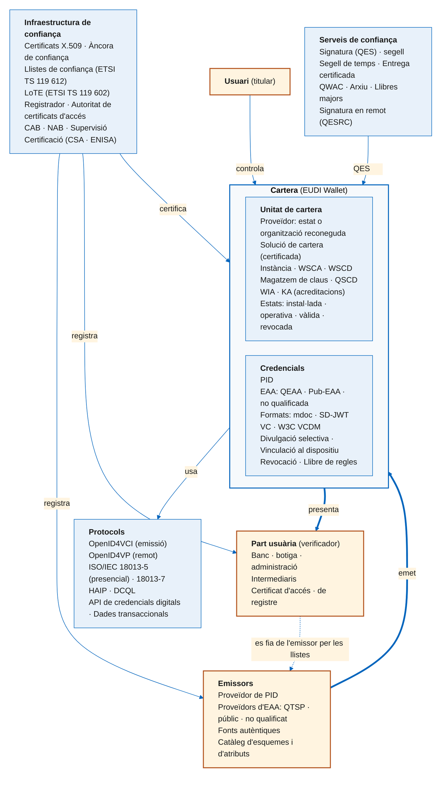

# Resum: el mapa d'eIDAS 2.0

---

## Tots els termes en un mapa

---

## Del reglament a la cartera

- **eIDAS** (2014) regulava la identificació electrònica i els serveis de confiança; **eIDAS 2.0** (2024) el modifica i crea el marc europeu d'identitat digital
- Els **actes d'execució** concreten els detalls tècnics; l'**ARF** explica com construir-ho, però no obliga
- El resultat és la **EUDI Wallet**: cada estat n'ha d'oferir almenys una, gratuïta, voluntària i de **nivell de garantia alt**

---

## De l'emissor a la part usuària

- Els **emissors** (proveïdor de PID; proveïdors de QEAA, Pub-EAA i EAA) emeten credencials a la cartera, comprovant les dades contra **fonts autèntiques**
- L'**usuari** les guarda a la seva **unitat de cartera** i decideix què presenta
- La **part usuària** demana atributs, registrada davant d'un **registrador** i identificada amb un **certificat d'accés**
- Al voltant, qui fa que tot sigui de fiar: **CAB**, **NAB**, organismes de supervisió i el **proveïdor de la cartera**

---

## De la credencial al protocol

- Dues menes de credencial: el **PID** (qui ets) i les **EAA** (què és cert sobre tu); més la **signatura qualificada** (QES)
- Dos formats obligatoris, **mdoc** i **SD-JWT VC**, amb el mateix patró: hashes amb sal, **divulgació selectiva** i **vinculació al dispositiu**
- Tres protocols: **OpenID4VCI** per emetre, **OpenID4VP** per presentar en remot, **ISO/IEC 18013-5** per presentar en persona
- **HAIP** fixa les opcions perquè tot sigui interoperable

---

## De la confiança a la privadesa

- Tot es verifica amb **certificats X.509** que encadenen fins a una **àncora** publicada en una **llista de confiança** (estats) o una **LoTE** (Comissió)
- Els **serveis de confiança** qualificats (signatura, segell, temps, entrega, arxiu, llibres majors) tenen presumpció legal de validesa
- El punt feble conegut és la **vinculabilitat**: els mètodes A–D mitiguen la de les parts usuàries; la de l'emissor només la resoldran les **proves de coneixement zero**
- Mentrestant, la **implementació de referència** i els **pilots** van provant tot plegat

---

## Idees clau del llibre

1. eIDAS 2.0 és la **SSI regulada**: el model d'interacció de la SSI, amb la confiança ancorada en el marc legal
2. L'usuari té el **control**: res no surt de la cartera sense la seva aprovació, i només els atributs necessaris
3. Tothom que participa està **registrat, acreditat o certificat**
4. Els **estàndards oberts** (OpenID, ISO, IETF, ETSI) són el que fa que una cartera d'un estat funcioni a tots els altres
5. Queden coses per resoldre, i la **privadesa forta** és la més important

---

## Per continuar

- El **[glossari](../../glossary.md)** té cada terme del mapa amb la definició i el tema on s'explica
- Els **[recursos](../../resources.md)** enllacen les fonts primàries: reglament, actes d'execució, ARF i especificacions
- Per a la pràctica, el tema 10: la implementació de referència es pot compilar i provar
